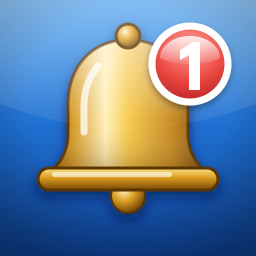

# hub-plugin-notify

An [Agents Hub](https://github.com/flagman/agents-hub-core) plugin: browser and macOS notifications about what matters
to the owner, without Telegram. A question for you, the hub's answer, a session's reply to your message, the result of
your task, a reminder about a question, a monitor's signal. A click opens the session; once a question is answered, its
notification is taken away.

Badge: while the hub tab is out of sight, every new notification adds to the number in the tab title "(N) <hub name>",
a red dot on its icon and the number on the app icon (a hub added to the Dock from Safari or installed from Chrome).
Back on the tab, it is cleared; an answered question leaves the count too. Works without the notification permission;
turned off in "Settings" → "Notifications". Safari does not show the dot on the tab icon: it takes the icon only when
the page loads.



The plugin does not change the hub core: its process reads the journal and writes to the plugin channel (API 1.2), the
page shows what it gets. The page texts follow the hub language (`hub.lang`, Plugin API 1.25): English by default,
Russian for a Russian hub.

## How it works

- `main.py` - the process next to the core (`run`). Reads the journal from the current place, `alerts.py` decides what
  deserves a notification, and each one goes as a post to the `notify` channel in the plugin's name.
- `web/main.js` - the page module. Reads the channel and shows what is new as a browser notification while the tab is
  out of sight; the "Settings" → "Notifications" tab. `web/badge.js` - the badge count and the tab title, without the
  DOM (test - `tests/test_badge_js.py`, needs node).
- `mac.py` + `mac_notify.swift` - macOS notifications when no page with browser notifications is open. The plugin
  builds the "Agents Hub" helper itself in `<state folder>/notify` (needs the Command Line Tools: `xcode-select
  --install`). The page checks in with the process every 10 s on `127.0.0.1:<page port + 8>`; the process accepts
  only requests from the hub page of this machine. On Linux and Windows this part is off: browser notifications and
  the badge work as everywhere.

## Tests

```
PYTHONPATH=<hub code folder>:. python3 -m unittest discover -s tests
```
